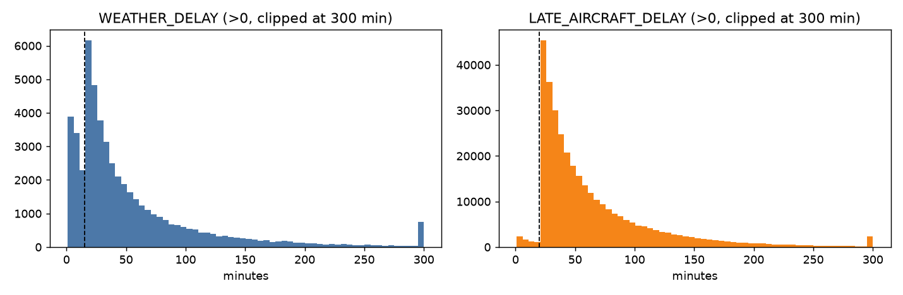
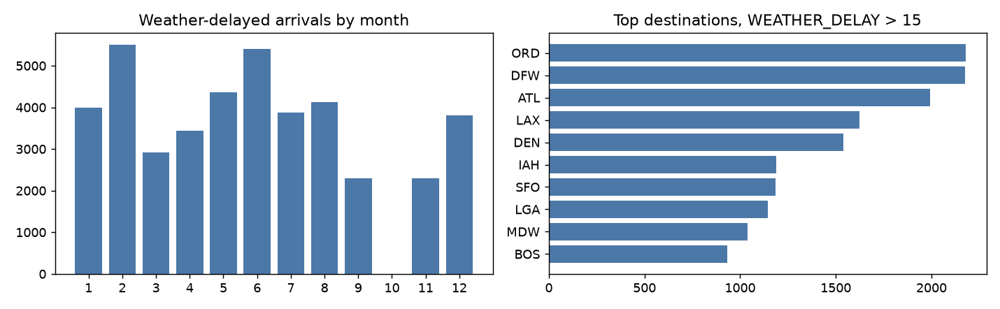
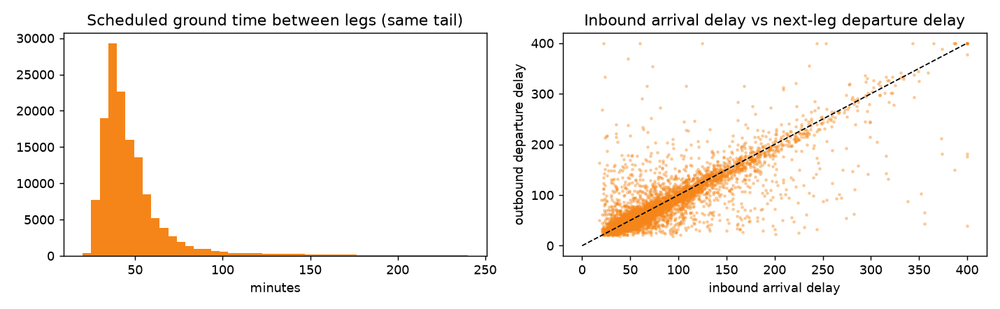
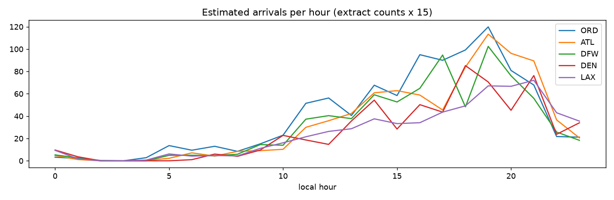

# EDA: US DOT 2015 delays, viewed through the three agents

## 1. What the files actually contain

- `flights.csv`: **358,774 rows x 31 columns**, 14 airlines, 320 destination airports, 4,745 airframes, 334 days.
- Months present: [1, 2, 3, 4, 5, 6, 7, 8, 9, 11, 12]. **Missing: [10]** (October 2015 in the public file uses numeric airport IDs; it has been dropped from this extract).
- **The file is pre-filtered.** Every row already satisfies the challenge rule: WEATHER_DELAY > 15 or LATE_AIRCRAFT_DELAY > 20 (100.0%). No cancellations (0), no diversions (0), minimum ARRIVAL_DELAY 16 min. Delay-cause columns have no nulls.
- Integrity: the five cause columns sum exactly to ARRIVAL_DELAY on 100.0% of rows.
- It is roughly **1/15 of all 2015 flights** for those months, so raw counts here understate real airport traffic. The scenario builder scales arrival density by this factor (an estimate).
- `airports.csv`: 322 airports; 3 lack coordinates: ['ECP', 'PBG', 'UST'] (weather lookups fall back to OurAirports for these).
- `airlines.csv`: 14 carriers, all present in flights.csv.

## 2. Disruption mix (drives scenario selection)

| bucket | rows | share |
|---|---:|---:|
| late-aircraft only (L>20, W<=15) | 316,762 | 88.3% |
| weather only (W>15, L<=20) | 32,525 | 9.1% |
| both (W>15 and L>20) | 9,487 | 2.6% |

Late-aircraft cascades dominate (the network problem: Ground and turnaround). Weather rows are the minority but carry the extreme tails (Pilot fuel and ATC runway capacity). An evaluation that samples rows uniformly would be ~90% late-aircraft cases, so the batch evaluator stratifies by bucket instead.

| percentile | WEATHER_DELAY (rows >15) | LATE_AIRCRAFT_DELAY (rows >20) |
|---|---:|---:|
| p50 | 42 | 47 |
| p75 | 80 | 81 |
| p90 | 143 | 132 |
| p95 | 197 | 172 |
| p99 | 361 | 272 |

Delays beyond ~172 min are no longer tactical (a 3-turn arrival negotiation cannot fix a multi-hour ground stop), so the scenario loader caps WEATHER_DELAY at 90 and LATE_AIRCRAFT_DELAY at 120 min and labels the rest as out-of-scope for live negotiation.

## 3. Pilot agent: weather exposure

- Peak weather months: [2, 6, 5] (summer convection plus winter storms). Holding-fuel stress is seasonal.
- Most exposed destinations: ORD, DFW, ATL, LAX, DEN. These are the airports where the Pilot agent most needs PIREPs (turbulence and icing in the hold) and METAR crosswinds.
- Long-haul share (distance >= 2000 mi, the HEAVY wake proxy): 4.7%. DOT has no aircraft type, so wake category and fuel burn are inferred from distance.

## 4. Ground agent: rotations, turnaround and propagation

- 144,744 same-tail, same-day rotations found in the extract.
- Scheduled ground time: median **40 min** (narrow-body proxy 40, long-haul proxy 56).
- Delay propagation: correlation between inbound arrival delay and the next departure delay is **0.76**; turnarounds absorb a median of 2 min. This is why Ground's turnaround and gate decisions matter: most of the delay rides straight into the next leg.

## 5. ATC agent: arrival density and taxi-in

- Estimated peak arrival rates: ORD 120/h, ATL 113/h, DFW 102/h, IAH 91/h, DEN 85/h. At 2-3 min wake spacing a single runway lands about 20-30 aircraft an hour, so the hubs are near capacity at peak and every displaced arrival competes for a scarce slot.
- Taxi-in (wheels-on to in-block): network median 6 min, p90 13 min; worst hubs by median: ORD 12, DFW 10, EWR 9, LAX 9, DTW 8.
- Used per airport: the near-terminal runway gets the median taxi-in, the far runway the p75.

## 6. Evaluation design (instead of a train/test split)

Nothing in the agents is trained, so a classic ML train/test split does not apply. What does apply when prompts are iterated: **tune on a dev set and report on a held-out test set**, or the prompts overfit the handful of rows you looked at. `batch_eval.py` assigns each row to dev or test by a stable hash of its identity and stratifies by disruption bucket (section 2) and severity (section 2 percentiles).

